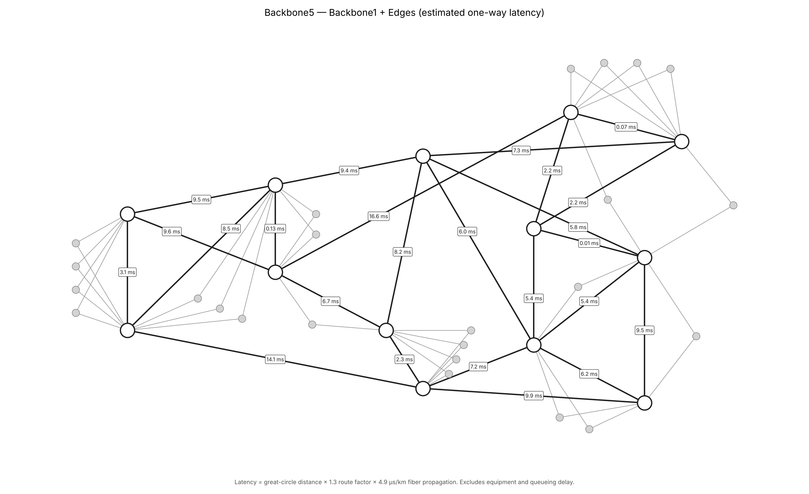

# Backbone5 — Backbone1 + Edges

NetworkX model of the Backbone1 core and its edges, built from the
`BackboneSplit` sheet of `Backbone-Split5.numbers`. Backbone2 is not included.



## What it shows

| Element | Style |
|---|---|
| Backbone1 sites (13) | White nodes, dark outline |
| Edge sites (24) | Light grey, small nodes |
| Backbone1 links (24) | Dark straight lines, labelled with estimated one-way latency |
| Edge links (48) | Grey straight lines |

Nodes are intentionally unlabelled.

## Latency estimate

Each Backbone1 link is labelled with an estimated one-way propagation delay,
derived from the site locations on the `Backbone1` sheet:

```
latency_ms = great_circle_km × 1.3 (route factor) × 4.9 µs/km (fiber) / 1000
```

This covers fiber propagation only — equipment, queueing and serialization
delay are excluded. `ROUTE_FACTOR` and `FIBER_US_PER_KM` are set at the top of
the script.

## Data handling

- Duplicate rows on the sheet (DRT–HAL1, CHI–ATL) are drawn once.
- `ASH1` in the Edges is treated as `ASH`.
- MXC is excluded: both of its links home to Backbone2-only sites (TC, DRT2).
- The Location cells "SEC1aucus NJ" and "HAL1sey NJ" are read as Secaucus and
  Halsey (Newark).

## Run

```bash
pip install networkx matplotlib numbers-parser
python backbone5_model.py Backbone-Split5.numbers backbone5_model.png
```

The script prints node and link counts, any rows it skipped or renamed, and a
table of every Backbone1 link with its distance and latency.
