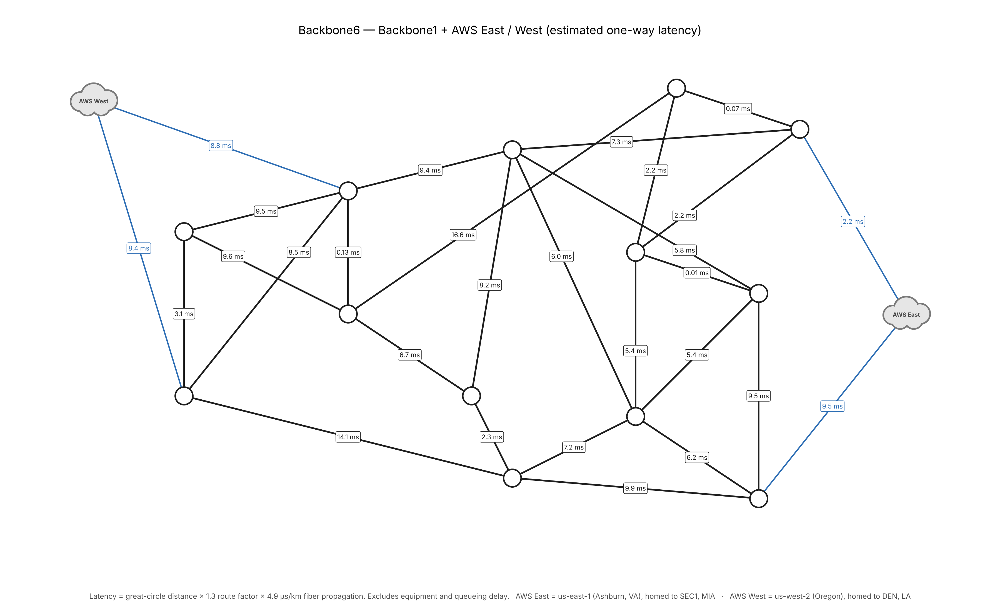
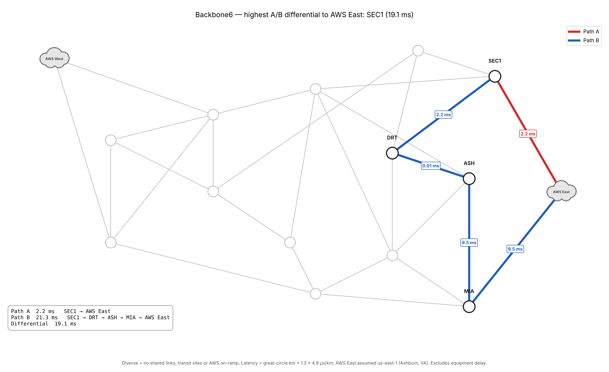

# Backbone6 — Backbone1 + AWS East / West

NetworkX model of the Backbone1 core with AWS cloud on-ramps. It is
[Backbone5](../backbone5/) with the edges removed and two AWS clouds added.
It is built from the `BackboneSplit` sheet of `Backbone-Split5.numbers`.
Backbone2 and the Edges block are not included.



## Changes from Backbone5

1. Edges removed (24 edge sites, 48 edge links)
2. AWS East added, homed to **SEC1** and **MIA**
3. AWS West added, homed to **DEN** and **LA**

## What it shows

| Element | Style |
|---|---|
| Backbone1 sites (13) | White nodes, dark outline |
| AWS East / AWS West (2) | Small grey cloud shapes, labelled |
| Backbone1 links (24) | Dark straight lines, labelled with estimated one-way latency |
| AWS links (4) | Blue straight lines, labelled with estimated one-way latency |

Backbone1 nodes are intentionally unlabelled. The cloud homing is set in
`CLOUDS` at the top of the script.

## Latency estimate

Each Backbone1 link is labelled with an estimated one-way propagation delay,
derived from the site locations on the `Backbone1` sheet:

```
latency_ms = great_circle_km × 1.3 (route factor) × 4.9 µs/km (fiber) / 1000
```

This covers fiber propagation only. Equipment, queueing and serialization
delay are excluded.

AWS links use the same formula, measured from the Backbone1 site to an assumed
AWS region (the same assumption as lowlatency-plan1/plan2):

| Cloud | Assumed region | Location used |
|---|---|---|
| AWS East | us-east-1 | Ashburn, VA (39.040, -77.490) |
| AWS West | us-west-2 | Oregon (45.840, -119.700) |

Change `CLOUD_COORDS` at the top of the script to use another region.

## Data handling

- Duplicate rows on the sheet (DRT–HAL1, CHI–ATL) are drawn once.
- The Location cells "SEC1aucus NJ" and "HAL1sey NJ" are read as Secaucus and
  Halsey (Newark).

## Run

```bash
pip install networkx matplotlib numbers-parser
python backbone6_model.py Backbone-Split5.numbers backbone6_model.png
```

The script prints node and link counts, the AWS homing, and tables of every
Backbone1 and AWS link with its distance and latency.

## Diverse A/B paths to AWS East

`diverse_paths.py` finds, for every Backbone1 site, the diverse Path A / Path B
pair to AWS East (no shared links, transit sites or on-ramp) with the lowest
combined latency, and the skew between them.

**Highest differential: SEC1 — 19.1 ms** (A 2.2 ms direct; B 21.3 ms via DRT,
ASH, MIA). SEC1 is itself an AWS East on-ramp, so this skew cannot be reduced.

Full table: [diverse_paths_aws_east.md](diverse_paths_aws_east.md)
(also [CSV](diverse_paths_aws_east.csv)).



```bash
python diverse_paths.py Backbone-Split5.numbers
```
