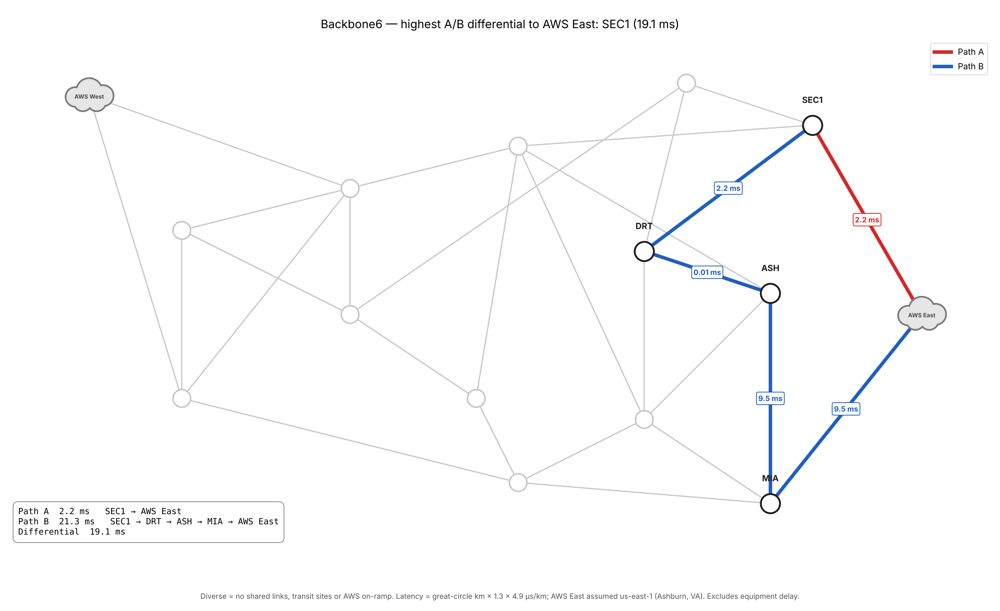

# Backbone6 — diverse A/B path latency to AWS East

Highest differential: **SEC1 — 19.1 ms** (A 2.2 ms direct, B 21.3 ms via DRT, ASH, MIA).

| Site | Path A | Path B | Differential | Min possible differential |
|---|---|---|---|---|
| **SEC1** | 2.2 ms — SEC1 → AWS East | 21.3 ms — SEC1 → DRT → ASH → MIA → AWS East | **19.1 ms** | 19.1 ms (2.2 / 21.3) |
| HAL1 | 2.3 ms — HAL1 → SEC1 → AWS East | 21.3 ms — HAL1 → DRT → ASH → MIA → AWS East | 18.9 ms | 1.3 ms (34.3 / 35.6) |
| DRT | 4.5 ms — DRT → SEC1 → AWS East | 19.1 ms — DRT → ASH → MIA → AWS East | 14.6 ms | 1.9 ms (19.1 / 21.0) |
| ASH | 4.5 ms — ASH → DRT → SEC1 → AWS East | 19.1 ms — ASH → MIA → AWS East | 14.6 ms | 1.9 ms (19.1 / 21.0) |
| CHI | 9.5 ms — CHI → SEC1 → AWS East | 21.8 ms — CHI → ATL → MIA → AWS East | 12.3 ms | 0.1 ms (32.7 / 32.7) |
| DEN | 18.9 ms — DEN → CHI → SEC1 → AWS East | 28.6 ms — DEN → DRY → DAL → HOU → MIA → AWS East | 9.7 ms | 0.1 ms (40.0 / 40.1) |
| DRY | 18.9 ms — DRY → HAL1 → SEC1 → AWS East | 28.4 ms — DRY → DAL → HOU → MIA → AWS East | 9.6 ms | 0.0 ms (39.8 / 39.8) |
| SNJ | 28.4 ms — SNJ → DEN → CHI → SEC1 → AWS East | 36.6 ms — SNJ → LA → HOU → MIA → AWS East | 8.2 ms | 0.1 ms (49.3 / 49.5) |
| LA | 27.4 ms — LA → DEN → CHI → SEC1 → AWS East | 33.5 ms — LA → HOU → MIA → AWS East | 6.1 ms | 0.0 ms (46.4 / 46.4) |
| ATL | 9.9 ms — ATL → DRT → SEC1 → AWS East | 15.8 ms — ATL → MIA → AWS East | 5.9 ms | 0.2 ms (15.5 / 15.8) |
| MIA | 9.5 ms — MIA → AWS East | 14.0 ms — MIA → ASH → DRT → SEC1 → AWS East | 4.5 ms | 4.5 ms (9.5 / 14.0) |
| DAL | 17.7 ms — DAL → CHI → SEC1 → AWS East | 21.8 ms — DAL → HOU → MIA → AWS East | 4.0 ms | 0.2 ms (29.9 / 30.0) |
| HOU | 17.1 ms — HOU → ATL → DRT → SEC1 → AWS East | 19.5 ms — HOU → MIA → AWS East | 2.4 ms | 0.4 ms (41.1 / 41.6) |

- **Diverse:** A and B share no links, transit sites or AWS on-ramp, so one path enters AWS East at SEC1 and the other at MIA.
- **Path A / Path B:** the diverse pair with the lowest combined latency; A is the lower-latency leg.
- **Min possible differential:** the lowest skew any diverse pair can reach (A / B latency shown), usually by routing both legs the long way.
- **Latency:** propagation estimate, great-circle km × 1.3 route factor × 4.9 µs/km fiber, AWS East assumed at us-east-1 (Ashburn, VA). Excludes equipment and queueing delay.
- SEC1 and MIA are the AWS East on-ramps, so their differential cannot be reduced: one leg is always the direct on-ramp.

