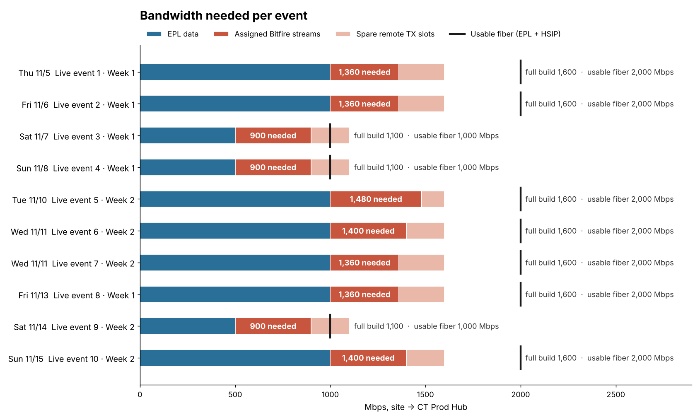
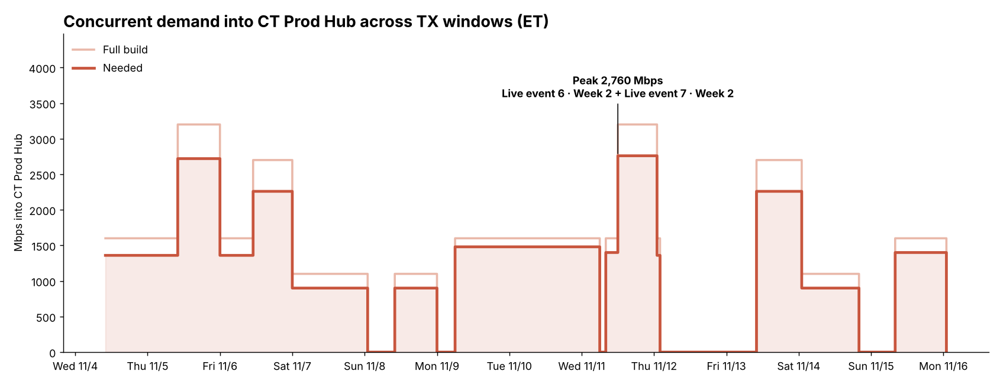
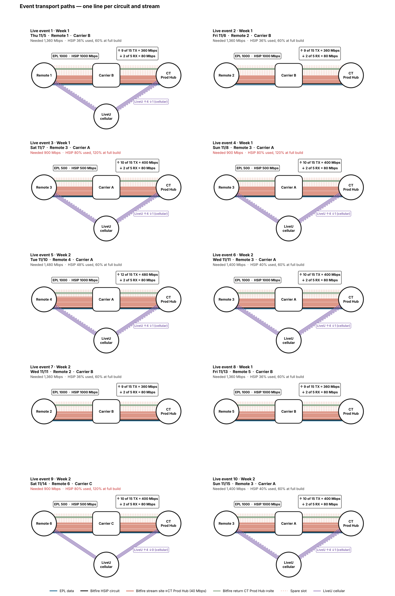

# Demand forecast — bandwidth per live event

Bandwidth needed per event for remote live productions, modelled in NetworkX
as one `MultiGraph` (remote → carrier → production hub, one edge per circuit
and per stream on each hop, plus a bonded-cellular backup path). Events,
remotes and carriers are named generically. **CT Prod Hub** is the production
hub every remote feeds.

## Ten events at a glance

| Game day | Event | Remote | Carrier | EPL data | HSIP | Streams up | Needed | Full build | HSIP used |
|---|---|---|---|--:|--:|--:|--:|--:|--:|
| Thu 11/5 | Live event 1 · Week 1 | Remote 1 | Carrier B | 1,000 | 1,000 | 9 of 15 | **1,360** | 1,600 | 36% |
| Fri 11/6 | Live event 2 · Week 1 | Remote 2 | Carrier B | 1,000 | 1,000 | 9 of 15 | **1,360** | 1,600 | 36% |
| Sat 11/7 | Live event 3 · Week 1 | Remote 3 | Carrier A | 500 | 500 | 10 of 15 | **900** | 1,100 | 80% |
| Sun 11/8 | Live event 4 · Week 1 | Remote 3 | Carrier A | 500 | 500 | 10 of 15 | **900** | 1,100 | 80% |
| Tue 11/10 | Live event 5 · Week 2 | Remote 4 | Carrier A | 1,000 | 1,000 | 12 of 15 | **1,480** | 1,600 | 48% |
| Wed 11/11 | Live event 6 · Week 2 | Remote 3 | Carrier A | 1,000 | 1,000 | 10 of 15 | **1,400** | 1,600 | 40% |
| Wed 11/11 | Live event 7 · Week 2 | Remote 2 | Carrier B | 1,000 | 1,000 | 9 of 15 | **1,360** | 1,600 | 36% |
| Fri 11/13 | Live event 8 · Week 1 | Remote 5 | Carrier B | 1,000 | 1,000 | 9 of 15 | **1,360** | 1,600 | 36% |
| Sat 11/14 | Live event 9 · Week 2 | Remote 6 | Carrier C | 500 | 500 | 10 of 15 | **900** | 1,100 | 80% |
| Sun 11/15 | Live event 10 · Week 2 | Remote 3 | Carrier A | 1,000 | 1,000 | 10 of 15 | **1,400** | 1,600 | 40% |

All figures in Mbps, venue → CT Prod Hub.

## What the demand says

- **Each event needs 900 – 1,480 Mbps** into the hub: the EPL data circuit
  plus 40 Mbps for each camera stream sent back. Seven of the ten are 1G
  builds needing 1,360 – 1,480.
- **Overlapping events set the real demand.** Four times in eleven days, two
  transmission windows are open at once:

  | When (ET) | Events | Needed | Full build |
  |---|---|--:|--:|
  | Wed 11/11 12:00 → Thu 11/12 01:00 | 6 + 7 | **2,760** | 3,200 |
  | Thu 11/5 10:00 → 23:59 | 1 + 2 | **2,720** | 3,200 |
  | Fri 11/6 11:00 → 23:59 | 2 + 3 | 2,260 | 2,700 |
  | Fri 11/13 10:00 → Sat 11/14 00:59 | 8 + 9 | 2,260 | 2,700 |

  Size the hub for at least **2.8 Gbps** of event ingest, and **3.2 Gbps** if
  overlapping shows light every slot. A third overlapping 1G show takes it
  past 4 Gbps.
- **A 500 Mbps HSIP holds 12 streams.** Events 3, 4 and 9 send 10 (80% of the
  circuit). Lighting all 15 remote TX slots (600 Mbps) would overrun it, so a
  show that may grow past 12 streams should be ordered on a 1G HSIP.
- **1G HSIP leaves room.** The seven 1G events use under half of theirs, so
  late camera adds there are safe.
- **One remote carries four of the ten events** (Remote 3), with about nine
  hours between events 3 and 4. Six remotes cover all ten shows.
- **Returns are small:** two program returns per event, 80 Mbps back to the
  venue. Bonded cellular (LiveU) is backup and not counted in the fiber totals.

## How each event connects

One straight line per circuit and per stream: EPL data (blue), the HSIP
circuit (black), each 40 Mbps camera stream up (red), returns down (green),
spare remote slots (dashed) and LiveU cellular (purple).

## Planning rules

- One stream is 40 Mbps.
- **Needed** = EPL data + assigned camera streams.
  **Full build** = EPL data + all 15 remote TX slots.
- Concurrency uses each event's transmission window (ET).
