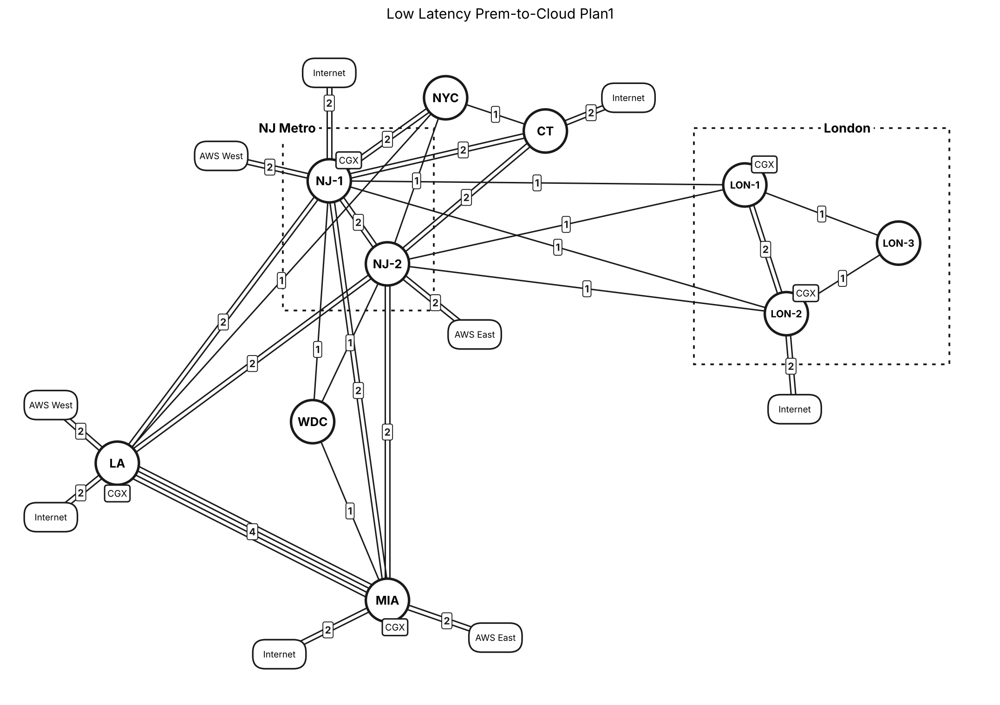

# Low Latency Prem-to-Cloud Plan1

NetworkX model of a low-latency premises-to-cloud backbone. It has ten sites with AWS and Internet on-ramps, laid out in compressed geography. Dotted regional boxes group the NJ Metro and London sites. Each circuit is modeled and drawn on its own, so a link with 2 or 4 circuits shows as 2 or 4 parallel straight lines.



## Files

| File | Purpose |
|---|---|
| `lowlatency_plan1_model.py` | Builds the graph, prints the resilience report, checks line and region visibility, and renders the PNG |
| `export_drawio.py` | Writes the same model as an uncompressed draw.io file (opens in draw.io and imports into Lucidchart), including the region boxes |
| `lowlatency_plan1_model.png`, `lowlatency_plan1.drawio`, `report.txt` | Generated outputs |

```bash
pip install networkx matplotlib
python lowlatency-plan1/lowlatency_plan1_model.py
python lowlatency-plan1/export_drawio.py
```

## The network

| Element | Detail |
|---|---|
| Sites (10) | LA, NJ-1, NJ-2, NYC, CT, WDC, MIA, LON-1, LON-2, LON-3. White circles; LA, NJ-1, MIA, LON-1 and LON-2 have a CGX badge |
| Regions | **NJ Metro** = NJ-1 + NJ-2; **London** = LON-1 + LON-2 + LON-3. Dotted boxes |
| Backbone | 22 links, 34 circuits. Straight parallel lines, one per circuit, with a count label |
| On-ramps | 9 AWS and Internet edges, 2 circuits each. AWS West at NJ-1 and LA, AWS East at NJ-2 and MIA, Internet at NJ-1, LA, MIA, CT and LON-2 |

## How it is modeled

- **`nx.MultiGraph` with one edge per circuit.** Each edge carries `circuit` and `of` (for example, circuit 2 of 4), so circuit counts come straight from the graph.
- **Regions.** `REGIONS` defines each dotted box: its member sites, padding, and where the label sits on the top or bottom edge. Each box automatically wraps its sites and their CGX badges.
- **Compressed geography.**
  - LA is in the west.
  - NJ Metro, NYC and CT are in the northeast.
  - WDC and MIA run down the east coast.
  - London is across the Atlantic.

  NJ-2 and NYC are nudged off their true bearings so no line passes through them.
- **Visibility checks.** Every run confirms that no line passes behind a site or cloud it doesn't connect to, and that no outside node falls inside a region box.

## Key findings

- **No single points of failure.** The backbone stays connected after losing any one site or any one link (node and edge connectivity are both 2).
- **NJ Metro is the core.** NJ-1 has 13 backbone circuits to 8 sites, and NJ-2 has 12 circuits to 8 sites.
- **London has 4 single circuits back to NJ Metro**: NJ-1–LON-1, NJ-1–LON-2, NJ-2–LON-1 and NJ-2–LON-2. LON-3 is reachable only through LON-1 and LON-2.
- **LA–MIA is the heaviest link**, with 4 circuits.
- **12 single-circuit links.** See `report.txt` for the full list.
