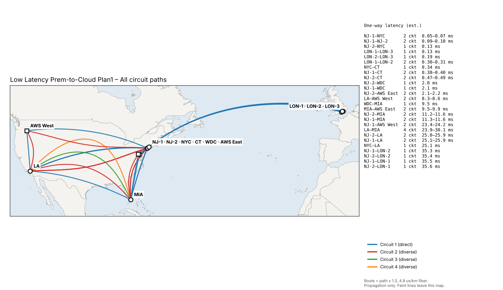
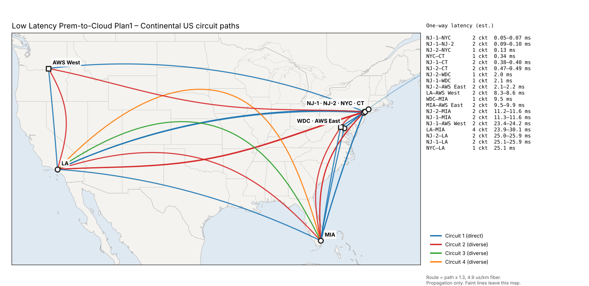
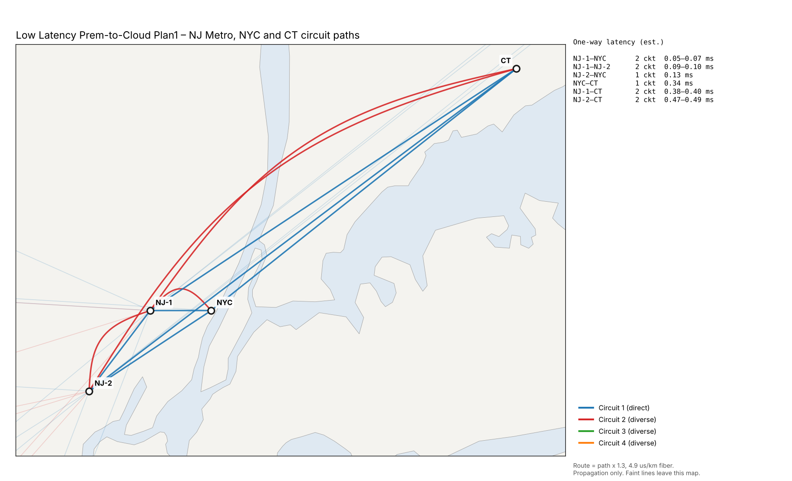
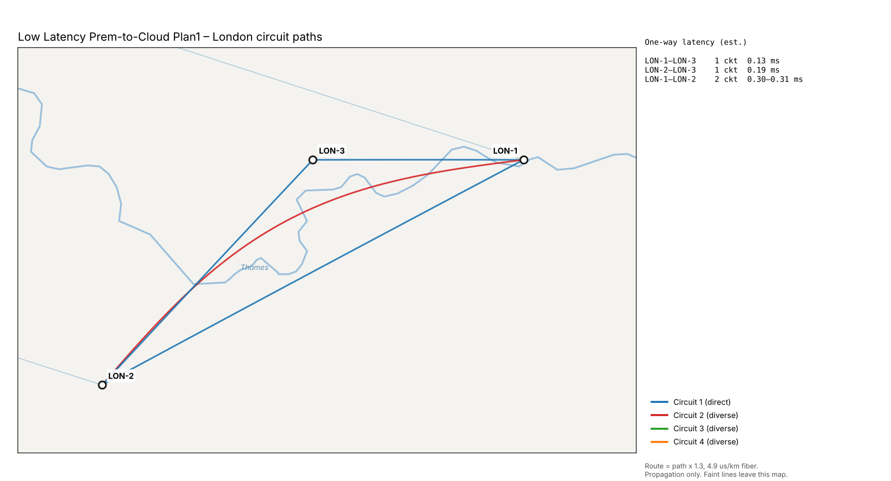

# Low Latency Prem-to-Cloud Plan1

NetworkX model of a low-latency premises-to-cloud backbone. It has ten sites with AWS and Internet on-ramps, laid out in compressed geography. Dotted regional boxes group the NJ Metro and London sites. Each circuit is modeled and drawn on its own, so a link with 2 or 4 circuits shows as 2 or 4 parallel straight lines. Every circuit also gets an estimated one-way latency on its own diverse path, and the paths are exported to Google Earth (KMZ).


## Files

| File | Purpose |
|---|---|
| `lowlatency_plan1_model.py` | Builds the graph, prints the resilience report, checks line and region visibility, and renders the PNG |
| `export_drawio.py` | Writes the same model as an uncompressed draw.io file (opens in draw.io and imports into Lucidchart), including the region boxes |
| `export_kmz.py` | Writes every estimated circuit path to a KMZ for Google Earth, plus the per-circuit path table as Markdown and CSV |
| `render_paths.py` | Renders the same paths as map images: overview, continental US, NJ/NYC metro and London (basemap: public-domain Natural Earth, downloaded on first run) |
| `lowlatency_plan1_model.png`, `lowlatency_plan1.drawio`, `report.txt` | Generated drawing, draw.io file and report |
| `lowlatency_plan1_paths.kmz`, [`circuit_paths.md`](circuit_paths.md), `circuit_paths.csv`, `paths_*.png` | Generated circuit paths, path table and path maps |

```bash
pip install networkx matplotlib
python lowlatency-plan1/lowlatency_plan1_model.py
python lowlatency-plan1/export_drawio.py
python lowlatency-plan1/export_kmz.py
python lowlatency-plan1/render_paths.py
```

## The network

| Element | Detail |
|---|---|
| Sites (10) | LA, NJ-1, NJ-2, NYC, CT, WDC, MIA, LON-1, LON-2, LON-3. White circles; LA, NJ-1, MIA, LON-1 and LON-2 have a CGX badge |
| Regions | **NJ Metro** = NJ-1 + NJ-2; **London** = LON-1 + LON-2 + LON-3. Dotted boxes |
| Backbone | 22 links, 34 circuits. Straight parallel lines, one per circuit, with a `circuits \| one-way ms` label |
| On-ramps | 9 AWS and Internet edges, 2 circuits each. AWS West at NJ-1 and LA, AWS East at NJ-2 and MIA, Internet at NJ-1, LA, MIA, CT and LON-2 |

## One-way latency estimates

Each link label on the drawing reads `circuits | one-way ms`. It shows a range when the link's circuits take routes of different lengths. Cloud labels give the latency to the assumed AWS region. Internet hand-offs are local, so they show the circuit count only.

**Method.** The calculation follows backbone5's convention, with one route per circuit:

- **Circuit 1** on a link takes the direct great-circle route between the two sites.
- **Each further circuit takes its own diverse route.** It's bowed out sideways by 12% of the link distance per step (3–600 km), so the 2nd circuit is one step out, the 3rd two steps, and so on. In North America the bow goes inland, toward the middle of the continental US, so alternates stay over land.
- **Route km** = path length × 1.3 route factor (fiber slack and rights-of-way).
- **One-way ms** = route km × 4.9 µs/km (light in single-mode fiber). This is propagation only; equipment, queueing and serialization delay are excluded.
- **AWS on-ramps** run to the assumed region: AWS East is us-east-1 (Ashburn, VA) and AWS West is us-west-2 (Oregon).
- **Site coordinates are rounded to about 10 km** (0.1°), so metro-link figures are approximate to a few hundredths of a millisecond.

**Estimated latency by link** (fastest to slowest):

| Link | Type | Circuits | Great-circle km | Est. route km | One-way ms |
|---|---|---:|---:|---:|---:|
| NJ-1–NYC | Backbone | 2 | 8 | 11–14 | 0.05–0.07 |
| NJ-1–NJ-2 | Backbone | 2 | 14 | 18–20 | 0.09–0.10 |
| NJ-2–NYC | Backbone | 1 | 20 | 26 | 0.13 |
| LON-1–LON-3 | Backbone | 1 | 21 | 27 | 0.13 |
| LON-2–LON-3 | Backbone | 1 | 30 | 40 | 0.19 |
| LON-1–LON-2 | Backbone | 2 | 47 | 61–63 | 0.30–0.31 |
| NYC–CT | Backbone | 1 | 54 | 70 | 0.34 |
| NJ-1–CT | Backbone | 2 | 60 | 79–81 | 0.38–0.40 |
| NJ-2–CT | Backbone | 2 | 74 | 96–99 | 0.47–0.49 |
| NJ-2–WDC | Backbone | 1 | 312 | 405 | 2.0 |
| NJ-1–WDC | Backbone | 1 | 325 | 423 | 2.1 |
| NJ-2–AWS East | AWS on-ramp | 2 | 336 | 437–452 | 2.1–2.2 |
| LA–AWS West | AWS on-ramp | 2 | 1,310 | 1,703–1,762 | 8.3–8.6 |
| WDC–MIA | Backbone | 1 | 1,491 | 1,938 | 9.5 |
| MIA–AWS East | AWS on-ramp | 2 | 1,497 | 1,946–2,013 | 9.5–9.9 |
| NJ-2–MIA | Backbone | 2 | 1,753 | 2,279–2,357 | 11.2–11.6 |
| NJ-1–MIA | Backbone | 2 | 1,766 | 2,296–2,375 | 11.3–11.6 |
| NJ-1–AWS West | AWS on-ramp | 2 | 3,680 | 4,784–4,944 | 23.4–24.2 |
| LA–MIA | Backbone | 4 | 3,753 | 4,878–6,136 | 23.9–30.1 |
| NJ-2–LA | Backbone | 2 | 3,931 | 5,110–5,280 | 25.0–25.9 |
| NJ-1–LA | Backbone | 2 | 3,938 | 5,120–5,290 | 25.1–25.9 |
| NYC–LA | Backbone | 1 | 3,947 | 5,131 | 25.1 |
| NJ-1–LON-2 | Backbone | 1 | 5,547 | 7,210 | 35.3 |
| NJ-2–LON-2 | Backbone | 1 | 5,560 | 7,228 | 35.4 |
| NJ-1–LON-1 | Backbone | 1 | 5,579 | 7,253 | 35.5 |
| NJ-2–LON-1 | Backbone | 1 | 5,593 | 7,270 | 35.6 |

### Path maps

The same paths as the KMZ, drawn on a map. Circuit 1 (blue) is the direct route; red, green and orange are the diverse routes. Each map lists its links and latency on the right. Faint lines are links that leave that map. Site positions are rounded to about 10 km.









Every circuit's path is a placemark in `lowlatency_plan1_paths.kmz`, colour-coded by circuit (1 = blue, 2 = red, 3 = green, 4 = orange). The per-circuit table is in [`circuit_paths.md`](circuit_paths.md) and `circuit_paths.csv`.

## How it is modeled

- **`nx.MultiGraph` with one edge per circuit.** Each edge carries `circuit` and `of` (for example, circuit 2 of 4), so circuit counts come straight from the graph.
- **Regions.** `REGIONS` defines each dotted box: its member sites, padding, and where the label sits on the top or bottom edge. Each box automatically wraps its sites and their CGX badges.
- **Compressed geography.**
  - LA is in the west.
  - NJ Metro, NYC and CT are in the northeast.
  - WDC and MIA run down the east coast.
  - London is across the Atlantic.

  NJ-2 and NYC are nudged off their true bearings so no line passes through them.
- **Visibility checks.** Every run confirms that no line passes behind a site or cloud it doesn't connect to, and that no outside node falls inside a region box.
- **Label placement.** Each `circuits | ms` label is placed automatically along its link, at the spot that crosses the fewest other lines, sites, badges and labels.

## Key findings

- **No single points of failure.** The backbone stays connected after losing any one site or any one link (node and edge connectivity are both 2).
- **NJ Metro is the core.** NJ-1 has 13 backbone circuits to 8 sites, and NJ-2 has 12 circuits to 8 sites.
- **London has 4 single circuits back to NJ Metro**: NJ-1–LON-1, NJ-1–LON-2, NJ-2–LON-1 and NJ-2–LON-2. LON-3 is reachable only through LON-1 and LON-2.
- **LA–MIA is the heaviest link**, with 4 circuits.
- **12 single-circuit links.** See `report.txt` for the full list.
- **Latency tiers:**
  - Inside NJ Metro and to NYC and CT: under 0.5 ms.
  - To WDC: about 2 ms.
  - To MIA: about 11–12 ms.
  - Coast to coast: about 25 ms.
  - To London: about 35–36 ms.
- **AWS West is about 8.3 ms from LA but about 23.4 ms from NJ-1**, so the LA on-ramp is the low-latency path to AWS West. AWS East is about 2.1 ms from NJ-2.
- **Diverse routes add about 3–4% on long-haul links.** LA–MIA's 4th circuit is the outlier at about 30 ms against 24 ms on the direct route, because it takes the longest inland loop.
