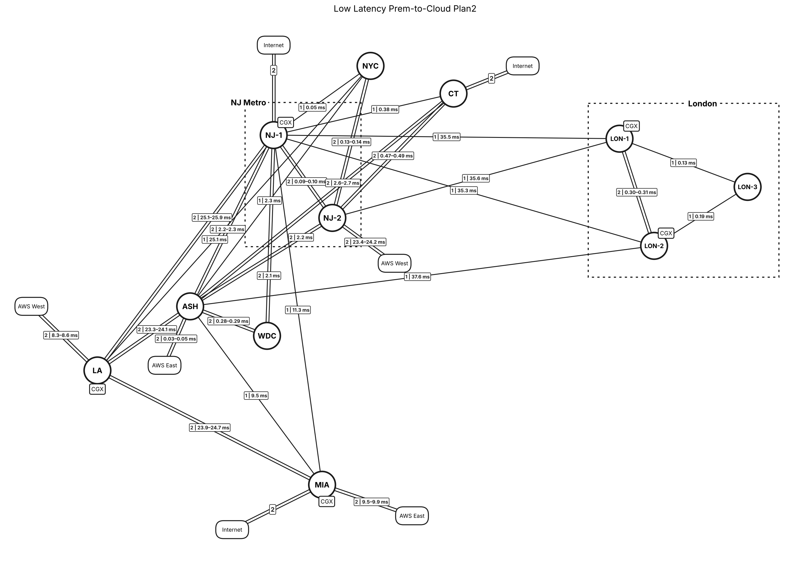

# Low Latency Prem-to-Cloud Plan2

NetworkX model of a low-latency premises-to-cloud backbone. It extends the [Plan1](../lowlatency-plan1/) footprint to eleven sites by adding **ASH** (Northern Virginia) as a second core hub, with AWS and Internet on-ramps, in compressed geography. Dotted regional boxes group the NJ Metro and London sites. Each circuit is modeled and drawn on its own, so a link with 2 circuits shows as 2 parallel straight lines. Every circuit also gets an estimated one-way latency on its own diverse path.



## Files

| File | Purpose |
|---|---|
| `lowlatency_plan2_model.py` | Builds the graph, prints the resilience and latency report, checks line and region visibility, and renders the PNG |
| `export_drawio.py` | Writes the same model as an uncompressed draw.io file (opens in draw.io and imports into Lucidchart), including the region boxes |
| `lowlatency_plan2_model.png`, `lowlatency_plan2.drawio`, `report.txt` | Generated drawing, draw.io file and report |

```bash
pip install networkx matplotlib
python lowlatency-plan2/lowlatency_plan2_model.py
python lowlatency-plan2/export_drawio.py
```

## The network

| Element | Detail |
|---|---|
| Sites (11) | LA, NJ-1, NJ-2, NYC, CT, ASH, WDC, MIA, LON-1, LON-2, LON-3. White circles. LA, NJ-1, MIA, LON-1 and LON-2 have a CGX badge |
| Regions | **NJ Metro** is NJ-1 and NJ-2. **London** is LON-1, LON-2 and LON-3. Both are dotted boxes |
| Backbone | 24 links, 36 circuits. Each circuit is its own straight parallel line, labelled `circuits \| one-way ms` |
| On-ramps | 7 AWS and Internet edges, 2 circuits each: AWS East at ASH and MIA, AWS West at NJ-2 and LA, and Internet at NJ-1, CT and MIA |

### How it differs from Plan1

- **ASH is a second hub.** Its 8 new links (13 circuits) go to NJ-1, NJ-2, NYC, CT, WDC, LA, MIA and LON-2.
- **NJ-2 is lighter.** Its links to LA, MIA, WDC and LON-2 are gone, so NJ-2 now reaches NJ-1, NYC, CT, ASH and LON-1.
- **NYC–CT and WDC–MIA are gone.** WDC now connects only to NJ-1 and ASH.
- **Circuit counts changed.**
  - Up: NJ-1–WDC and NJ-2–NYC each go to 2.
  - Down: NJ-1–NYC, NJ-1–CT and NJ-1–MIA each go to 1, and LA–MIA goes from 4 to 2.
- **London homing:** NJ-1 has a circuit to each of LON-1 and LON-2, NJ-2 has one to LON-1, and ASH has one to LON-2.
- **The on-ramps moved.** AWS East is at ASH and MIA (Plan1: NJ-2 and MIA). AWS West is at NJ-2 and LA (Plan1: NJ-1 and LA). Internet is no longer at LA or LON-2.

## One-way latency estimates

Each link label on the drawing reads `circuits | one-way ms`. It shows a range when the link's circuits take routes of different lengths. Cloud labels give the latency to the assumed AWS region. Internet hand-offs are local, so they show the circuit count only.

**Method.** This is the same as Plan1, with one route per circuit:

- **Circuit 1** on a link takes the direct great-circle route.
- **Each further circuit** takes its own diverse route, bowed out further each time. In North America the bow goes inland, so alternates stay over land.
- **Route km** = geometric path length × 1.3, to allow for fiber slack and rights-of-way.
- **One-way ms** = route km × 4.9 µs/km, the speed of light in single-mode fiber. This is propagation only; equipment, queueing and serialization delay are excluded.
- **AWS on-ramps** run to the assumed region: AWS East is us-east-1 (Ashburn, VA) and AWS West is us-west-2 (Oregon).
- **Site coordinates are rounded to about 10 km** (0.1°), so metro-link figures are approximate to a few hundredths of a millisecond.

**Estimated latency by link** (fastest to slowest):

| Link | Type | Circuits | Great-circle km | Est. route km | One-way ms |
|---|---|---:|---:|---:|---:|
| ASH–AWS East | AWS on-ramp | 2 | 5 | 6–10 | 0.03–0.05 |
| NJ-1–NYC | Backbone | 1 | 8 | 11 | 0.05 |
| NJ-1–NJ-2 | Backbone | 2 | 14 | 18–20 | 0.09–0.10 |
| NJ-2–NYC | Backbone | 2 | 20 | 26–28 | 0.13–0.14 |
| LON-1–LON-3 | Backbone | 1 | 21 | 27 | 0.13 |
| LON-2–LON-3 | Backbone | 1 | 30 | 40 | 0.19 |
| WDC–ASH | Backbone | 2 | 45 | 58–60 | 0.28–0.29 |
| LON-1–LON-2 | Backbone | 2 | 47 | 61–63 | 0.30–0.31 |
| NJ-1–CT | Backbone | 1 | 60 | 79 | 0.38 |
| NJ-2–CT | Backbone | 2 | 74 | 96–99 | 0.47–0.49 |
| NJ-1–WDC | Backbone | 2 | 325 | 423–438 | 2.1 |
| NJ-2–ASH | Backbone | 2 | 339 | 441–456 | 2.2 |
| NJ-1–ASH | Backbone | 2 | 352 | 458–474 | 2.2–2.3 |
| NYC–ASH | Backbone | 1 | 359 | 467 | 2.3 |
| CT–ASH | Backbone | 2 | 413 | 537–555 | 2.6–2.7 |
| LA–AWS West | AWS on-ramp | 2 | 1,310 | 1,703–1,762 | 8.3–8.6 |
| ASH–MIA | Backbone | 1 | 1,493 | 1,940 | 9.5 |
| MIA–AWS East | AWS on-ramp | 2 | 1,497 | 1,946–2,013 | 9.5–9.9 |
| NJ-1–MIA | Backbone | 1 | 1,766 | 2,296 | 11.3 |
| ASH–LA | Backbone | 2 | 3,663 | 4,762–4,921 | 23.3–24.1 |
| NJ-2–AWS West | AWS on-ramp | 2 | 3,677 | 4,780–4,940 | 23.4–24.2 |
| LA–MIA | Backbone | 2 | 3,753 | 4,878–5,041 | 23.9–24.7 |
| NJ-1–LA | Backbone | 2 | 3,938 | 5,120–5,290 | 25.1–25.9 |
| NYC–LA | Backbone | 1 | 3,947 | 5,131 | 25.1 |
| NJ-1–LON-2 | Backbone | 1 | 5,547 | 7,210 | 35.3 |
| NJ-1–LON-1 | Backbone | 1 | 5,579 | 7,253 | 35.5 |
| NJ-2–LON-1 | Backbone | 1 | 5,593 | 7,270 | 35.6 |
| LON-2–ASH | Backbone | 1 | 5,898 | 7,667 | 37.6 |

## How it is modeled

- **`nx.MultiGraph` with one edge per circuit.** Each edge carries `circuit` and `of` (for example, circuit 2 of 2), so circuit counts come straight from the graph.
- **Regions.** `REGIONS` defines each dotted box: its member sites, padding, and where the label sits on the top or bottom edge. Each box automatically wraps its sites and their CGX badges.
- **Compressed geography.**
  - LA is in the west.
  - NJ Metro, NYC and CT are in the northeast.
  - ASH, WDC and MIA run down the east coast.
  - London is across the Atlantic.

  NJ-2 is nudged off its true bearing so the CT–ASH circuits don't pass through it.
- **Visibility checks.** Every run confirms that no line passes behind a site or cloud it doesn't connect to, and that no outside node falls inside a region box.
- **Label placement.** Each `circuits | ms` label is placed automatically along its link, at the spot that crosses the fewest other lines, sites, badges and labels.

## Key findings

- **No single points of failure.** The backbone stays connected after losing any one site or any one link (node and edge connectivity are both 2).
- **Two hubs: NJ-1 and ASH.** NJ-1 has 13 backbone circuits to 9 sites, ASH has 13 to 8, and NJ-2 has 9 to 5.
- **London has 4 single circuits back to the US**: NJ-1–LON-1, NJ-1–LON-2, NJ-2–LON-1 and ASH–LON-2. LON-3 is reachable only through LON-1 and LON-2.
- **12 single-circuit links.** See `report.txt` for the full list.
- **Latency tiers:**
  - Inside NJ Metro and to NYC and CT: under 0.5 ms.
  - NJ Metro, NYC and CT to ASH and WDC: about 2–2.7 ms.
  - To MIA: about 9.5 ms from ASH and 11.3 ms from NJ-1.
  - Coast to coast: about 23–26 ms.
  - To London: about 35–38 ms.
- **ASH sits next to AWS East** (about 0.05 ms), so the NJ Metro sites reach AWS East in about 2.2 ms via ASH.
- **AWS West is about 8.3 ms from LA but about 23.4 ms from NJ-2**, so the LA on-ramp is the low-latency path to AWS West.
